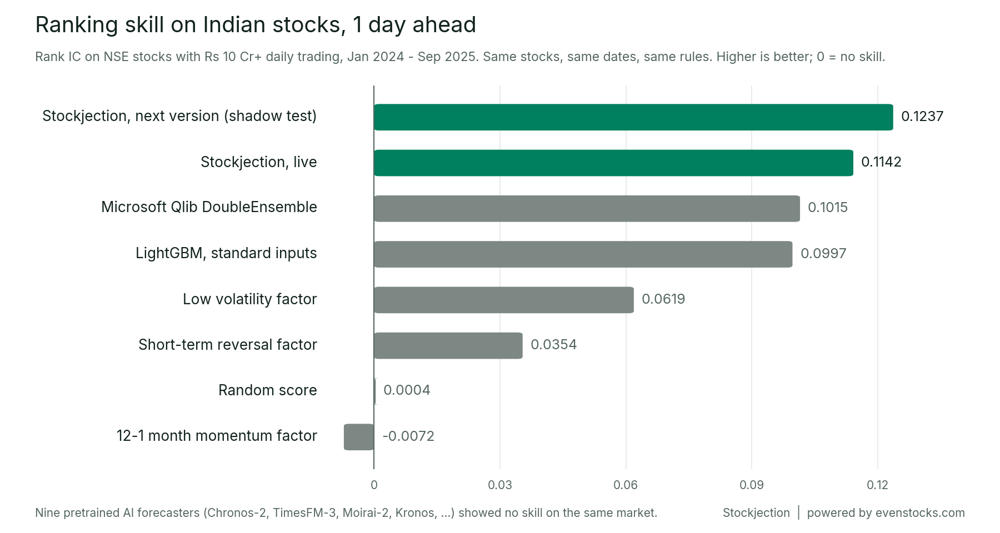
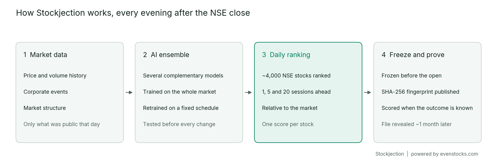

# Stockjection

### AI stock ranking for Indian equities, tested in the open

Every evening it ranks about 4,000 NSE stocks for the next day, week and month.
Results are published as they come, good or bad. Every forecast is fingerprinted before the market opens.

Powered by **[evenstocks.com](https://evenstocks.com/?utm_source=github&utm_medium=readme&utm_campaign=stockjection&utm_content=top_link)**

---

**Stockjection beats every open benchmark we tested on Indian stocks.** On the same stocks, the same dates and the same rules
it ranks above Microsoft Qlib's DoubleEnsemble, a standard LightGBM, nine pretrained AI forecasting models (Chronos-2,
TimesFM-3, Moirai-2, Kronos and others) and the classic public factors.

<picture>
  <source media="(prefers-color-scheme: dark)" srcset="assets/leaderboard_dark.png">
  
</picture>

## In numbers

| | |
|---|---|
| **0.1142** | live model's 1-day rank IC on tradable NSE stocks (Qlib DoubleEnsemble on the same data: 0.1015) |
| **59.2 %** | of its top and bottom 2 % calls beat or lagged the market as called (random: 49.9 %) |
| **+0.346 % a day** | for a simple 5 long + 5 short book in backtest, after trading costs (Jan 2024 - Sep 2025) |
| **223** | numbered experiments, each with its pass / fail rule written before it ran: 44 passed, 152 failed |
| **0 of 9** | pretrained AI forecasting models that showed any skill on NSE stocks |

## Leaderboard

Same test for every model: NSE stocks the paper book can trade (EQ series, 20-session mean traded value of at least Rs 10 crore,
no circuit lock), January 2024 to September 2025, every model scored only on dates it never trained on. **IC** = average daily
rank correlation between a model's score and each stock's next return relative to the market (higher is better; 0 = no skill).
**Book** = five longs and five shorts each day, open to close of the next session, after 30.6 bps of trading costs.

| # | Model | IC 1 day | IC 5 days | IC 20 days | Top/bottom 2 % calls right (1 day) | Book, % per day (t) |
|---|---|---|---|---|---|---|
| 1 | **Stockjection, next version** (in shadow test) | **0.1237** | **0.1141** | – | **60.5 %** | **+0.380** (7.6) |
| 2 | **Stockjection, live** | 0.1142 | 0.1088 | **0.1235** | 59.2 % | +0.346 (6.7) |
| 3 | Microsoft Qlib DoubleEnsemble (on our data) | 0.1015 | 0.0902 | 0.1003 | 57.6 % | +0.214 (4.0) |
| 4 | LightGBM, standard inputs | 0.0997 | 0.0956 | 0.1058 | 56.9 % | +0.134 (2.2) |
| 5 | Low volatility (public factor) | 0.0619 | 0.0581 | 0.0856 | 53.2 % | −0.074 (−1.7) |
| 6 | Short-term reversal (public factor) | 0.0354 | 0.0256 | 0.0059 | 50.3 % | −0.485 (−7.4) |
| 7 | 12-1 month momentum (public factor) | −0.0072 | 0.0023 | −0.0007 | 51.1 % | −0.323 (−6.6) |
| 8 | Random score | 0.0004 | 0.0008 | 0.0025 | 49.9 % | −0.285 (−7.9) |
| – | 9 pretrained AI forecasters (Chronos-2, TimesFM-3, Moirai-2, TiRex, Sundial, Toto, Kronos, Time-MoE, …) | no skill: none beat a "no change" forecast; about 50 % direction | | | | |

Full table with per-year results: [leaderboard/LEADERBOARD.md](leaderboard/LEADERBOARD.md).

**Read this with care**
- These are historical (development) results. The dates were used many times during research; the "next version" was
  chosen on these same dates, so its lead is optimistic.
- Private and commercial models publish no comparable record, so they are not on the board.
- The real test is live: see [Live track record](#live-track-record).

## How it works

<picture>
  <source media="(prefers-color-scheme: dark)" srcset="assets/how_it_works_dark.png">
  
</picture>

Stockjection is a ranking model: it does not guess prices, it orders stocks by how they are likely to do **relative to the
market**. An ensemble of complementary AI models, trained on point-in-time Indian market data (price and volume history,
corporate events and market structure, each as it was known that day), produces one score per stock. The model design,
inputs and settings are proprietary.

## Why the numbers can be trusted

- **Rules before results.** Every experiment's pass/fail rule is written down before it runs; most ideas fail
  ([research/RESULTS.md](research/RESULTS.md)).
- **Same rows for every model.** No model is scored on dates it trained on.
- **Costs included.** Brokerage, STT, stamp duty, exchange fees, GST and slippage are charged in every book result.
- **Honest statistics.** Day-to-day dependence is handled (Newey-West t); a year-by-year check is part of every rule.
- **A sealed year.** October 2025 to October 2026 is kept out of this leaderboard.
- **Forecasts you can verify.** Fingerprinted before the open, revealed later (below).

How we test: [docs/METHOD.md](docs/METHOD.md).

## Live track record

Live results matter more than any backtest, so they are published as they come, good or bad. Full log: [live/LIVE.md](live/LIVE.md).

| Since | What | Result so far |
|---|---|---|
| 17 Nov 2026 | Paper trading, 5 longs + 5 shorts a day, Rs 1 lakh, real prices and costs | −3.3 % after 5 sessions: a poor start (only 2.3 % of 5-day stretches in the backtest were this bad) |
| 20 Nov 2026 | Shadow test of the next version against the live model | 1 scored day so far; at least 10 are needed before any conclusion |

## Forecast proof: fingerprinted before the open, checkable later

Every evening the day's ranking (stock, horizon, rank) is frozen and its SHA-256 fingerprint is committed to
[forecasts/commitments.csv](forecasts/commitments.csv) before the next market open. About a month later, once every horizon
has played out, the exact file is published. Anyone can check that it matches the fingerprint published in advance, so no
forecast can be edited after the fact. How to verify: [forecasts/README.md](forecasts/README.md).

## Challenge the leaderboard

Have a model for Indian stocks? Open an issue with your method, the dates it was trained on and how it was scored. If it can be
evaluated on the same rows and rules, it goes on the board, including if it beats Stockjection.

## Roadmap

- [x] Ensemble model live, forecasts frozen and fingerprinted every evening
- [x] Open leaderboard against Qlib, LightGBM, foundation models and public factors
- [x] Paper trading with real prices and costs
- [ ] 10 scored shadow days, then the decision on the next version (December 2026)
- [ ] First month of live paper trading reviewed (late December 2026)
- [ ] First forecast files revealed and verifiable (late December 2026)
- [ ] New data types in research

## Stay in the loop

- **Star this repository** to follow the live results as they land.
- **[Visit evenstocks.com](https://evenstocks.com/?utm_source=github&utm_medium=readme&utm_campaign=stockjection&utm_content=footer_link)**: research for Indian investors, by the team behind Stockjection.

## Not investment advice

Stockjection is research. Nothing here is a recommendation to buy, sell or hold any security, and nothing here is a target price.
We are not registered with SEBI as investment advisers or research analysts. Past and simulated results do not guarantee
future results. Paper trading is simulated. Do your own research.

## License

Text, tables and figures: [CC BY 4.0](LICENSE). The model, its design, weights, inputs and data are proprietary and not part of
this repository.

---

Powered by **[evenstocks.com](https://evenstocks.com/?utm_source=github&utm_medium=readme&utm_campaign=stockjection&utm_content=bottom_link)**

